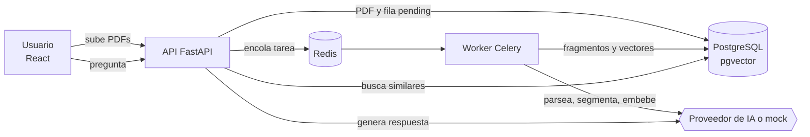
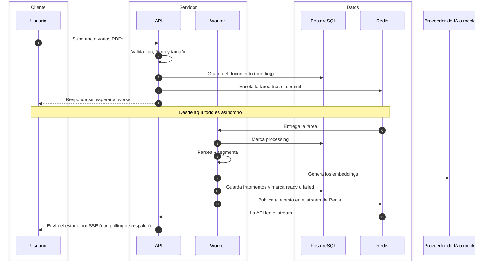
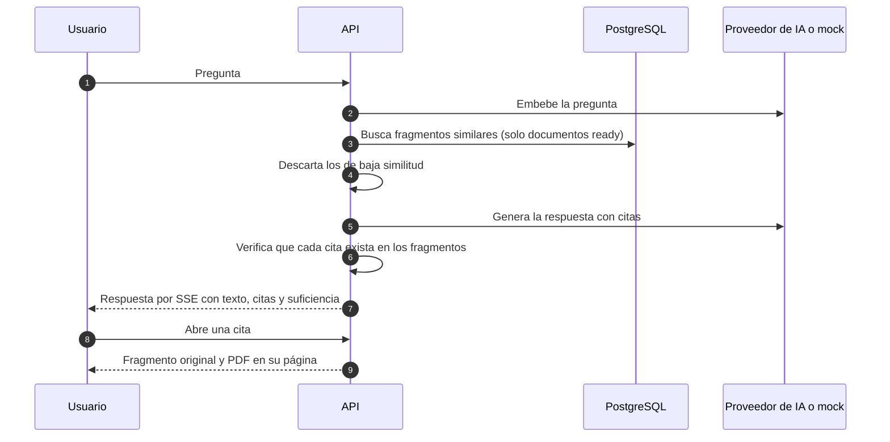
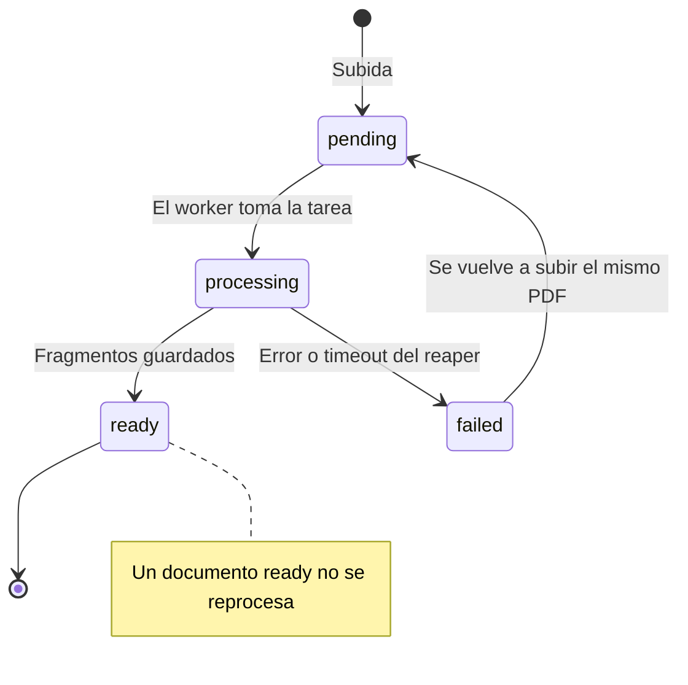

# Asistente RAG de contratos — Naviera Portecho

MVP interno para subir contratos PDF, procesarlos en segundo plano y consultarlos en lenguaje natural.
Cada respuesta cita documento, página y fragmento, y dice "No hay evidencia suficiente" cuando el
contexto recuperado no la respalda.

Monorepo: `backend/` (FastAPI y Celery), `frontend/` (React y TypeScript), y `docker-compose.yml`. Más detalle: [`docs/ARCHITECTURE.md`](docs/ARCHITECTURE.md),
[`docs/PRD.md`](docs/PRD.md) y [`DECISIONS.md`](DECISIONS.md).

## Levantar todo con un comando

```bash
docker compose up --build
```

No necesita claves: por defecto usa los proveedores **mock** deterministas (LLM y embeddings).
Opcionalmente `cp .env.example .env` para cambiar puertos o proveedores.

| Servicio | URL |
|---|---|
| Frontend (subida, documentos, chat) | http://localhost:3000 |
| API + Swagger | http://localhost:8000/docs |
| Flower (colas y tareas Celery) | http://localhost:5555 (usuario `admin`, clave `admin`) |
| Jaeger (trazas OpenTelemetry) | http://localhost:16686 |

Servicios: `api`, `worker`, `beat` (reaper de documentos atascados), `redis`, `db` (PostgreSQL 16 + pgvector),
`frontend`, `flower`, `jaeger`.
La API aplica las migraciones de Alembic al arrancar y expone `GET /health`; el resto de servicios que
dependen de ella (por ejemplo el frontend) esperan a que esté sana.

### Usar Gemini real

```bash
LLM_PROVIDER=gemini LLM_API_KEY=<clave> LLM_MODEL=gemini-2.0-flash \
EMBEDDING_PROVIDER=gemini EMBEDDING_API_KEY=<clave> EMBEDDING_MODEL=gemini/text-embedding-004 \
docker compose up --build
```

### Usar OpenAI (o un endpoint compatible)

```bash
LLM_PROVIDER=openai LLM_API_KEY=<clave> LLM_MODEL=gpt-4.1-mini \
LLM_BASE_URL=https://api.openai.com/v1 \
EMBEDDING_PROVIDER=openai EMBEDDING_API_KEY=<clave> EMBEDDING_MODEL=text-embedding-3-small \
EMBEDDING_BASE_URL=https://api.openai.com/v1 \
docker compose up --build
```

Con `LLM_BASE_URL` apuntando a `api.openai.com` el LLM usa la API Responses (`/v1/responses`), porque
los modelos de razonamiento rechazan en chat completions las *function tools* con las que Pydantic AI
obtiene la salida estructurada. Con cualquier otro endpoint compatible (NVIDIA NIM, vLLM, Ollama,
OpenRouter) usa chat completions. `text-embedding-3-small` admite `EMBEDDING_DIMENSIONS=768`.

Los embeddings pasan por LiteLLM y el LLM por Pydantic AI. Los vectores son de 768 dimensiones
(`EMBEDDING_DIMENSIONS`); si cambias a un modelo con otra dimensión hay que crear una migración nueva y
reindexar.

### Desarrollo local (sin compose completo)

`make help` lista los comandos: `make infra-up` (db + redis), `make migrate`, `make api`, `make worker`,
`make web`. `MOCK=1` fuerza los proveedores mock.

### Flower: colas y tareas de Celery

Flower solo corre en el `docker compose` completo. En desarrollo hay que levantarlo aparte con
`make flower` (en su propia terminal): escucha en http://127.0.0.1:5555 y pide usuario y clave. Si no
defines `FLOWER_BASIC_AUTH` en `.env`, genera una clave aleatoria y la imprime al arrancar.

Muestra los workers (pool, concurrencia y tareas registradas), la cola del broker y cada tarea con su
estado, duración y reintentos: `process_document` por cada documento, y `fail_stuck_documents` cada
minuto cuando corre `beat` (solo en el compose). No hace falta activar eventos en el worker: Flower los
habilita él mismo. Su historial vive en memoria, así que se pierde al reiniciarlo.

## Pruebas y evaluación

```bash
cd backend
uv sync --dev
uv run ruff format --check . && uv run ruff check . && uv run mypy src tests
uv run pytest -m unit            # unitarias, sin I/O externo
uv run pytest -m integration     # PostgreSQL (pgvector) y Redis reales vía Testcontainers; requiere Docker

cd ../frontend
bun install && bun run typecheck && bun run lint && bun run test
```

**Evaluación de recuperación** (hit rate@k sobre 4 contratos sintéticos, 14 preguntas):

```bash
cd backend
uv run python eval/run_eval.py                         # configuración por defecto (500 / 80)
uv run python eval/run_eval.py --chunk-chars 400 --overlap 50   # explorar otra segmentación
uv run python eval/generate_contracts.py               # regenera los PDFs (determinista)
```

Los contratos están en `backend/eval/contracts/`, las preguntas y respuestas esperadas en
`backend/eval/qa.json` (12 respondibles + 2 sin evidencia para medir la abstención). Corre offline con el
embedding mock. Con `--min-hit-rate-at-5 0.9` termina con error si el hit rate@5 baja de 0,9 (por
defecto no falla).

## Cómo funciona

### Visión general



### Ingesta

El usuario no espera al procesamiento: la API responde en cuanto guarda el documento y el resto ocurre
en el worker. Cuando el worker cambia el estado de un documento publica un evento en un Redis Stream;
la API lo lee y lo envía al navegador por SSE (`GET /api/v1/documents/events`), de modo que la lista
se actualiza sin sondear. Redis tiene dos papeles distintos: broker de las tareas de Celery y
stream de eventos. Detalles y garantías de entrega en [`docs/ARCHITECTURE.md`](docs/ARCHITECTURE.md).



### Consulta



### Ciclo de vida de un documento



### Trazas

Una subida produce una sola traza de OpenTelemetry, visible en Jaeger. El contexto viaja en las
cabeceras de la tarea de Celery:

```
POST /documents/upload-batch            API
├─ db.query
└─ apply_async/process_document
   └─ run/process_document              worker, mismo trace_id
      └─ index.document
         ├─ index.parse
         ├─ index.chunk
         ├─ index.embed
         ├─ index.persist
         └─ db.query
```

Una consulta genera `rag.embed_query`, `rag.retrieve`, `rag.build_prompt`, `llm.generate` (o
`llm.generate_stream` en el endpoint de streaming, con tiempo hasta el primer token y fragmentos
emitidos), `rag.validate_citations` y las llamadas HTTP al proveedor, más un `db.query` por sentencia
SQL. Los spans llevan atributos de decisión (fragmentos sobre el umbral, citas aceptadas y rechazadas)
y nunca el texto de la pregunta ni de los contratos. Los logs son JSON e incluyen `trace_id` y `span_id`. El exportador se
elige con `OTEL_TRACES_EXPORTER=otlp|console|none` (`otlp` envía OTLP/HTTP a
`OTEL_EXPORTER_OTLP_ENDPOINT`, por defecto Jaeger).

## Proveedores reales y mock

- **Mock (por defecto):** los embeddings son un hash determinista por palabra (sin acentos ni
  stopwords) y las respuestas son extractivas a partir de los fragmentos recuperados. Todo funciona
  sin claves.
- **Gemini u OpenAI (`LLM_PROVIDER` y `EMBEDDING_PROVIDER` = `gemini` | `openai`):** embeddings vía
  LiteLLM (por ejemplo `gemini/text-embedding-004` o `text-embedding-3-small`) y respuesta con
  Pydantic AI y salida estructurada. Es el único camino que registra tokens en las trazas.
- Todos pasan por el mismo validador de citas. El camino con Gemini no se ha probado con claves
  reales; el de OpenAI se probó con `gpt-6-luna` y `text-embedding-3-small`.
- Timeouts (`LLM_TIMEOUT`, `EMBEDDING_TIMEOUT`) y hasta 3 intentos con backoff ante fallos
  transitorios. Si se agotan, la API responde 503 (no disponible), 429 (cuota) o 502 (respuesta
  inválida).

## Estado

Hecho:
- Subida de uno o varios PDFs con estados `pending`, `processing`, `ready` y `failed` (con motivo).
- Tarea Celery por etapas, idempotente: sin duplicados ante re-subidas, reentregas, reintentos o
  workers muertos (`acks_late` y un reaper en Celery Beat).
- pgvector con índice HNSW y migraciones.
- Consulta con salida estructurada, citas verificadas y abstención.
- Frontend con tres vistas; las citas abren el fragmento original y el PDF en su página.
- Eventos de dominio entre procesos sobre Redis Streams, publicados tras el commit y entregados al
  navegador por SSE con reanudación (`Last-Event-ID`); el polling queda como respaldo.
- Flower, Jaeger y OpenTelemetry de la API al worker y la base de datos.

No hecho:
- Búsqueda híbrida y reranking.
- Versionado de parser y modelo de embeddings (hoy se reemplaza).
- Permisos por documento o equipo.
- OCR para PDFs escaneados.
- Medición con un proveedor real, y una prueba matando un contenedor de worker real (hoy solo se
  simula en las pruebas de integración).
- *Outbox* transaccional: un evento se pierde si el worker muere entre el commit y su publicación
  (la interfaz lo compensa con un sondeo lento).

## Rendimiento medido

Medido de extremo a extremo contra `docker compose` (API, worker con 2 procesos, PostgreSQL y Redis en
contenedores) con los contratos de ejemplo y los proveedores **mock**. Máquina: Apple M2, Docker con 8 CPU
y 8 GB. Se reproduce con el stack levantado:

```bash
cd backend && uv run python eval/benchmark.py --base-url http://localhost:8000
```

| Métrica (pila caliente) | p50 | p95 |
|---|---|---|
| Ingesta por documento (subida hasta `ready`, 2 a 4 páginas) | 69 ms | 139 ms |
| Ingesta por página | 35 ms | 65 ms |
| `POST /query`, 1 cliente (150 peticiones) | 4,7 ms | 11,5 ms |
| `POST /query`, 4 clientes en paralelo (150 peticiones) | 13 ms | 28 ms |

La evaluación de calidad da hit rate@1, @3 y @5 de 0,75, 0,92 y 0,92, con abstención 2/2.

Cómo leer estas cifras:
- **Son una cota inferior.** El mock no hace llamadas de red: con un proveedor real, la consulta añade la latencia
  del modelo (la parte dominante) y la ingesta añade la de los embeddings. Eso no está medido.
- Los PDFs de ejemplo son de 2 a 4 páginas, así que el tiempo "por página" incluye costes fijos
  (subida, encolado, sondeo cada 50 ms) y sobrestima el de un PDF largo.
- La primera tarea tras arrancar el worker tarda unos 1.000 ms (arranque en frío: importaciones y
  conexiones). Las cifras de arriba son con el worker ya caliente.
- Con 20 documentos y 150 peticiones el p95 es orientativo, no estadísticamente robusto.

Para escalar cambiaría: más réplicas del worker, embeddings en lotes asíncronos, un pool de conexiones
y `hnsw.ef_search` ajustado, caché de embeddings de consultas y el almacenamiento de PDFs en S3 o
MinIO en vez de un volumen local.

## Limitaciones conocidas

- Sin autenticación ni aislamiento por área: cualquiera con acceso a la red ve todos los contratos
  (`DECISIONS.md` §5).
- Recuperación solo vectorial: los códigos exactos o importes pueden fallar donde una búsqueda léxica
  acertaría.
- Si un worker muere sin manejar el error, el documento sigue como `processing` hasta que Redis
  reentrega la tarea (unos 10 min) o el reaper lo marca `failed` (a los 15 min).
- La evaluación usa 4 contratos sintéticos y el embedding mock. Detecta regresiones, no predice la
  calidad con contratos reales.
- Los PDFs escaneados terminan en `failed` con un motivo legible; no hay OCR.
- El contenedor del frontend ejecuta el servidor de desarrollo de Vite, no una build estática.
