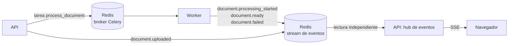

# Arquitectura

Monorepo con una API FastAPI, un worker Celery, un frontend React y la infraestructura en
`docker-compose.yml`. Este documento describe lo que hay en el código; las decisiones y sus
alternativas están en [`DECISIONS.md`](../DECISIONS.md).

## Componentes

| Componente | Tecnología | Dónde |
|---|---|---|
| API | FastAPI, Pydantic v2, SQLAlchemy async | `backend/src/maritime/main.py` |
| Worker y planificador | Celery + Redis (broker y resultados), Celery Beat | `backend/src/maritime/infrastructure/celery/` |
| Base de datos | PostgreSQL 16 + pgvector, migraciones Alembic | `backend/migrations/` |
| LLM y embeddings | Pydantic AI (LLM: Gemini, OpenAI o compatible), LiteLLM (embeddings), mock determinista | `modules/rag/infrastructure/llm/`, `modules/indexing/infrastructure/embeddings/` |
| Frontend | React, TypeScript, Vite, TanStack Router y Query, Zustand, shadcn/ui | `frontend/src/` |
| Observabilidad | OpenTelemetry, Jaeger v2, Flower | `core/telemetry/`, `docker-compose.yml` |

## Backend

Un monolito modular con tres módulos. Cada uno separa `domain/` (entidades, puertos),
`application/` (casos de uso), `infrastructure/` (adaptadores) y `presentation/` (routers y esquemas):

- `ingestion`: subida, estado y listado de documentos, PDF original.
- `indexing`: tarea de indexación (parseo, segmentación, embeddings, persistencia) y fragmentos.
- `rag`: recuperación, generación con salida estructurada y validación de citas.

Los casos de uso dependen de puertos (`IDocumentRepository`, `IFileStorage`, `IPdfParser`,
`IChunkingService`, `IEmbeddingService`, `IChunkRepository`, `IQueryEngine`, `ILlmService`) y
`infrastructure/di/container.py` los ensambla. El proveedor real o mock se elige con
`LLM_PROVIDER` y `EMBEDDING_PROVIDER` (`mock`, `gemini` u `openai`). Con `openai` y
`LLM_BASE_URL` en `api.openai.com`, el adaptador usa la API Responses; con otro endpoint compatible usa
chat completions (los modelos de razonamiento no aceptan en chat completions las *function tools* que
Pydantic AI usa para la salida estructurada).

### Comandos y eventos

El sistema separa dos cosas que usan Redis de formas distintas:

- **Comandos (Celery):** "procesa este documento" es una tarea que debe ejecutarse una vez, con
  reintentos e idempotencia. Viaja por el broker de Celery (Redis, bases 0 y 1).
- **Eventos (Redis Streams):** "el documento pasó a `ready`" es un hecho ya ocurrido que cualquier
  proceso puede escuchar. Viaja por un stream de Redis (base 2).



Cada `ContractDocument` registra sus eventos de dominio (`document.uploaded`,
`document.processing_started`, `document.ready`, `document.failed`) y quien lo guarda los publica en
un `IEventBus`. El bus de cada proceso (`infrastructure/events/`) se compone así:

- **`DeferredEventBus`:** retiene los eventos hasta que la transacción hizo commit y los publica
  entonces. Si hay rollback se descartan. Así nadie se entera de datos que aún no son visibles.
- **`RelayEventBus`:** entrega cada evento a los suscriptores locales del proceso y lo añade al
  stream de Redis para los demás procesos. Un fallo de Redis se registra y no rompe la petición ni
  la tarea: el estado ya está confirmado en la base de datos.

El único suscriptor local es el de `document.uploaded`, que encola la tarea de Celery. Se queda
fuera del stream a propósito: el stream entrega al menos una vez a quien lo lee, y un "encola esto"
duplicado podría hacer que dos workers procesen el mismo documento a la vez.

**Del stream al navegador.** Cada instancia de la API tiene un consumidor que lee el stream desde su
cola actual (con ids concretos, sin saltarse entradas entre lecturas) y reparte los eventos a los
clientes conectados a `GET /api/v1/documents/events` (SSE). El `id` de cada evento es el id del
stream, así que un cliente que se reconecta con `Last-Event-ID` recibe lo que se perdió. Un cliente
demasiado lento se corta y se reconecta, en vez de acumular memoria.

Los sobres de los eventos (`core/events/envelope.py`) llevan un nombre estable (`document.ready`, no
una ruta de clase), una versión y el `traceparent`, de modo que un productor y un consumidor se
pueden desplegar por separado y la traza continúa a través del stream.

### Garantías de entrega

| Canal | Garantía |
|---|---|
| Comando (tarea de Celery) | Al menos una vez; la tarea es idempotente |
| Evento hacia el stream | Como máximo una vez: si el worker muere entre el commit y la publicación, el evento se pierde |
| Stream hacia el navegador | Al menos una vez, con reanudación por `Last-Event-ID` |

Un evento perdido no deja datos incorrectos: la interfaz mantiene un sondeo lento de respaldo y
vuelve a consultar el listado cada vez que (re)conecta el SSE. Si hiciera falta la garantía completa,
el siguiente paso es un *outbox* transaccional (guardar el evento en la misma transacción y
reenviarlo después).

### Estados de un documento

```
pending ──► processing ──► ready
   ▲            │
   └─ re-subida ┴──► failed (con motivo legible en error_detail)
```

Un documento `ready` no se reprocesa. Re-subir el mismo PDF de un documento `failed` lo devuelve a
`pending` y lo encola de nuevo. Un reaper de Celery Beat marca `failed` los que llevan demasiado
tiempo en `processing`.

### Errores

`core/exceptions.py` define la jerarquía de errores de dominio. Los fallos del proveedor
(`ProviderError`) llevan un tipo (`unavailable`, `quota`, `malformed`) que la API traduce a 503, 429
y 502 con un mensaje legible y sin contenido del proveedor.

## Flujo de datos

1. `POST /api/v1/documents/upload` (o `upload-batch`): valida extensión, firma `%PDF-` y tamaño,
   calcula el SHA-256 y guarda archivo y fila (`pending`). Tras el commit se encola la tarea.
2. `process_document`: marca `processing` y confirma esa transacción antes del trabajo lento, para
   que otros procesos (la interfaz, el reaper) lo vean mientras ocurre; después parsea con pdfplumber
   (tablas a Markdown), segmenta, genera embeddings, escribe todos los fragmentos en una sola
   operación y marca `ready` o `failed`. Cada confirmación va seguida de su evento.
3. `POST /api/v1/query` (y `/query/stream` por SSE): embebe la pregunta, busca por distancia coseno
   en pgvector (solo documentos `ready`), descarta fragmentos bajo el umbral, llama al LLM y valida
   que cada cita exista en los fragmentos recuperados.
4. `GET /api/v1/documents/{id}/chunks/{chunk_id}` y `/file`: permiten abrir el fragmento original
   y el PDF desde una cita.

## Trazas y logs

`FastAPIInstrumentor` y `CeleryInstrumentor` propagan el contexto, de modo que una subida produce
una sola traza que une la petición HTTP, el encolado y la tarea del worker. Spans manuales:
`index.document`, `index.parse`, `index.chunk`, `index.embed`, `index.persist`, `event.publish`,
`event.consume` (continúa la traza del publicador a través del stream), `rag.embed_query`,
`rag.retrieve`, `rag.build_prompt`, `llm.generate` o `llm.generate_stream` (con tokens, tiempo hasta el
primer token y fragmentos emitidos), `rag.validate_citations`, las llamadas HTTP al proveedor y
`db.query` (uno por sentencia SQL). Los spans de RAG llevan atributos de decisión (fragmentos
recuperados y sobre el umbral, citas propuestas, aceptadas y rechazadas). Los logs son JSON
con `trace_id` y `span_id`. El exportador se configura con `OTEL_TRACES_EXPORTER`.

## Frontend

Estructura por funcionalidad en `frontend/src/features/`:

- `upload`: zona de arrastre con varios archivos y validación con Zod.
- `documents`: tabla con filtro por estado en la URL. Se actualiza con los eventos del SSE
  (`useDocumentEvents`, montado en la raíz); si la conexión cae, vuelve al polling cada 2 s, y con la
  conexión abierta mantiene un sondeo lento de 30 s como respaldo.
- `chat`: conversación con respuesta en streaming (SSE), citas y panel lateral con el fragmento
  original resaltado y enlace al PDF en la página citada.

Las rutas viven en `src/routes/` (TanStack Router) y el cliente HTTP en `src/shared/api/`.

## Infraestructura y pruebas

`docker compose up --build` levanta `db`, `redis`, `api` (aplica migraciones al arrancar y tiene un
healthcheck en `/health` que esperan los demás servicios), `worker`,
`beat`, `flower`, `frontend` y `jaeger`. El frontend ejecuta el servidor de desarrollo de Vite con
proxy a la API. Flower pide usuario y clave (`FLOWER_BASIC_AUTH`, por defecto `admin:admin` en el
compose) y solo escucha en `127.0.0.1`, porque desde su interfaz se pueden apagar workers. La API arranca con `--timeout-graceful-shutdown 5` porque las conexiones SSE abiertas
retrasarían el cierre ordenado de uvicorn.

- Backend: `pytest -m unit` (sin I/O externo) y `pytest -m integration` (PostgreSQL y Redis reales
  con Testcontainers). Lint con Ruff y tipos con mypy estricto.
- Frontend: Vitest con happy-dom, `tsc` y Oxlint.
- Evaluación de recuperación: `backend/eval/run_eval.py` (ver el README).
